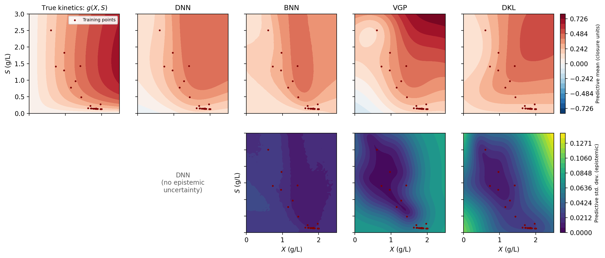
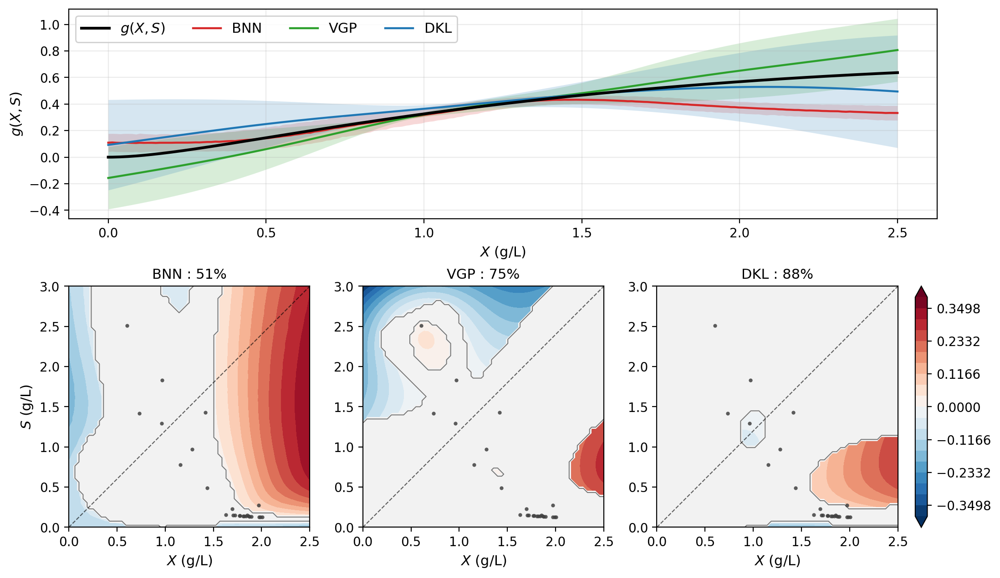

# Probabilistic Hybrid Modeling with Variational Deep Kernel Learning

Reference implementation for **"Scalable Probabilistic Hybrid Modeling in
Data-Scarce Regime via Integration of First-Principles ODEs with Variational
Deep Kernel Learning."**

The code learns an unknown constitutive relation — a reaction rate, a growth
rate — that sits *inside* a known set of balance equations, using only a handful
of sparse and noisy state trajectories. The closure is represented by a deep
kernel: a neural feature extractor followed by a sparse variational Gaussian
process. Because the closure is never observed directly, it is trained by
propagating sampled closure functions through a differentiable ODE solver and
comparing the resulting trajectories with the measurements.

The point of the probabilistic treatment is that with this little data, many
different closures fit the observations equally well. A deterministic model
picks one and says nothing about the others; this one reports where the data
constrain the closure and where they do not.

**Note that this Readme file was written using Claude Opus 5: If there are any challenges in implementation: kindly contact kudva.7@osu.edu**

---

## What the model recovers

Below, five models attempt to recover a withheld Haldane-type growth law from
**five** trajectories with **five** measurements each. The top row is the
predictive mean against the true kinetics; the bottom row is the predictive
standard deviation. Maroon points mark the states the training trajectories
actually visited.



All four models look reasonable near the data. They differ in what they claim
away from it. The BNN reports low uncertainty in regions its mean surface gets
wrong; the VGP, restricted to a stationary kernel in the original coordinates,
distorts the surface shape. DKL's uncertainty grows with distance from the
training support, which is the behavior you want if the model is going to inform
a decision.

The same comparison, scored: the shaded bands are the ±3σ function-level
intervals, and the contour panels show the signed error *only where the true
kinetics fall outside those bands*.



Coverage is 88% for DKL against 75% for the VGP and 51% for the BNN, and the
uncovered regions are smaller and less structured.

---

## Installation

```bash
git clone https://github.com/<user>/<repo>.git
cd <repo>
pip install -r requirements.txt
```

Python 3.9+. The main dependencies are PyTorch, GPyTorch and torchdiffeq. CPU is
fine — the models are small, and a GPU is unlikely to help at this scale (see
*Computational cost* below).

---

## Quick start

Every script has a configuration dictionary at the top and runs with no
arguments, either from an IDE or as `python <script>.py`.

```bash
# 1. Train. Edit ABLATION_CONFIG["case"] to "cstr" or "bioreactor".
python run_ablation.py

# 2. Draw the figures from the saved checkpoints.
python plot_ablation_4panel.py results/ablation_cstr_full/checkpoint/ablation_results.pkl
python plot_spatial_coverage.py
python plot_kinetic_surfaces.py
```

Step 1 trains four closures across `N in {1,3,5,10,20}` for 10 repeats each and
saves every model. It takes a while. Reduce `n_repeats` or `n_values` first if
you only want to see it work.

---

## The two benchmarks

Both are synthetic, so the withheld kinetics are known and recovery can actually
be measured — which is the whole point of the evaluation.

**Isothermal CSTR** (`systems/cstr.py`). Known material balances for `A -> B`;
the withheld rate is Langmuir–Hinshelwood with product inhibition. The same rate
enters both balances with opposite sign.

**Fed-batch bioreactor** (`systems/bioreactor.py`). Known biomass and substrate
balances with a known yield coefficient; the withheld rate is Haldane-type
substrate inhibition with a logistic biomass term.

A Lotka–Volterra system is also included for testing.

## The four closures

| | Uncertainty | Kernel operates in |
|---|---|---|
| `mlp` (DNN) | none — deterministic reference | — |
| `bnn` | weight space, mean-field | — |
| `vgp` | function space | original state coordinates |
| `dkl` | function space | learned feature space |

`vgp` vs `dkl` is the controlled comparison: same variational formulation, same
inducing-point budget (`M_Z = 30`), same data, same ARD squared-exponential base
kernel. The only difference is where the kernel acts.

---

## Evaluation

All metrics are computed on a fixed 60×60 grid defined in `config.GRID_BOUNDS` —
hard-coded per case, not inferred from the trajectories, so every script and
every seed evaluates on the same domain.

- **Grid NLL** — Gaussian negative log-likelihood of the true kinetics under the
  predictive distribution. Penalizes both overconfident errors and uselessly
  wide intervals.
- **Grid MAE** — error of the predictive mean alone. Read alongside the NLL, it
  separates *recovering the surface* from *rescaling the uncertainty*.
- **Coverage area** — fraction of grid points where the true rate falls inside
  the ±3σ band.
- **Trajectory coverage** — pointwise containment of 100 held-out test
  trajectories in nominal 95% intervals.

The first three ask whether the *closure* was recovered; the last asks whether
the *trajectories* were. They can disagree, and when they do, the function-level
metrics are the more informative ones.

---

## Sensitivity studies

```bash
python sensitivity_mc_featdim.py        # M_S x feature dimension
python sensitivity_samples_per_traj.py  # K at fixed N
python sensitivity_timing.py            # where training time goes
```

Each also exposes `main_plot()`, which redraws from saved results without
retraining:

```python
import sensitivity_mc_featdim as s
s.main_plot(opts={"layout": "paired"})       # per-seed differences
s.main_plot(opts={"source": "checkpoints"})  # re-evaluate saved weights
```

The `"paired"` layout is worth knowing about. Seeds are shared across
configurations, so every cell trains on identical data from an identical
initialization. Differencing within a seed cancels the seed variance and
resolves effects that independent error bars cannot.

`source="checkpoints"` reads the saved weights rather than the results pickle —
useful when a sweep was run in batches and the pickle was overwritten.

### Computational cost

The profiling study splits training into the GP posterior (including the
Cholesky of `K_ZZ`), the feature extractor, the integrator, and the backward
pass. The result is consistent across settings: **the GP posterior dominates the
forward computation and the integrator is a few percent of it.**

The reason is that the closure is evaluated once per *solver stage*, not once
per rollout. With forward Euler at `T = 60`, that is 60 GP evaluations per
trajectory per sample. Switching to RK4 would quadruple it. Cost therefore
scales with the number of stages rather than with the step size, and a coarser
time grid is not automatically cheaper.

This also explains why a GPU is unlikely to help here: the work is many small
sequential kernel launches, not large dense algebra. Batching the Monte Carlo
rollouts and caching the `K_ZZ` factorization are the changes that would matter.

---

## Repository layout

```
config.py                       hyperparameters, case definitions, GRID_BOUNDS
run_ablation.py                 main experiment (entry point)
systems/                        cstr, bioreactor, lotka_volterra + true kinetics
surrogates/                     mlp, bnn, vgp, dkl + integrator-in-the-loop training
evaluate.py                     trajectory-level metrics
plotting.py                     figure routines used by the ablation

plot_ablation_4panel.py         metrics vs N, four panels
plot_spatial_coverage.py        +/-3 sigma coverage and violation maps
plot_kinetic_surfaces.py        recovered means and uncertainties
plot_loss_curves.py             training loss vs epoch (convergence diagnostic)
figure_utils.py                 checkpoint loaders, fixed-grid reconstruction

sensitivity_mc_featdim.py       M_S x n_z sweep
sensitivity_samples_per_traj.py K sweep at fixed N
sensitivity_timing.py           cost decomposition
sensitivity_utils.py            shared harness for the sensitivity studies
backfill_grid_metrics.py        add metrics to an old sweep without retraining
```

---

## Reproducibility notes

Worth knowing if you plan to compare runs.

**Seeding.** `run_ablation.py` re-seeds before every model fit, so a model's
initialization depends only on the repeat index, not on its position in
`TRAIN_ORDER`. Adding or removing a baseline does not silently change the
others, and the sensitivity studies reproduce the ablation's DKL fit exactly at
matched settings.

**Epochs matter more than you would expect.** Grid NLL is strongly dependent on
training length. For the CSTR at `N = 5`, a single DKL fit gives roughly:

| epochs | 25 | 75 | 1000 |
|---|---|---|---|
| grid NLL | +1.08 | +0.01 | −0.51 |

Short runs produce large positive NLL that reflects undertraining, not a problem
with the model. Keep `epochs = 1000` for anything you intend to report.

**The evaluation grid is fixed in `config.py`.** Earlier versions inferred it
from the trajectories with padding, which meant different scripts silently
evaluated on different domains. If you change `GRID_BOUNDS`, every metric moves,
so regenerate all figures together.

---

## Citation

```bibtex
@article{kudva2026hybrid,
  title   = {Scalable Probabilistic Hybrid Modeling in Data-Scarce Regime via
             Integration of First-Principles {ODE}s with Variational Deep
             Kernel Learning},
  author  = {Kudva, Akshay and Shah, Parth and Kim, Taehyun and Cho, Hangjun
             and Kwon, Joseph Sang-Il},
  journal = {},
  year    = {2026}
}
```

## License

See `LICENSE`.
