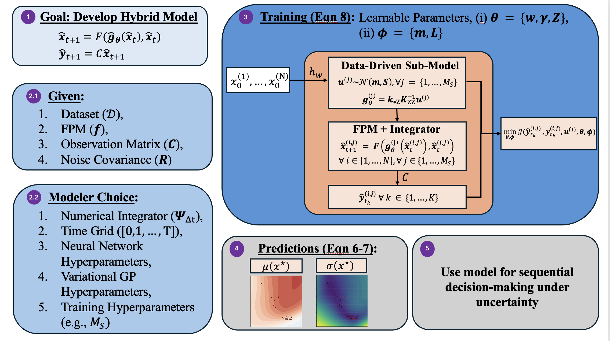

# Probabilistic Hybrid Modeling in Data-Scarce Regime via Integration of First-Principles ODEs with Variational Deep Kernel Learning

**Akshay Kudva, Parth Shah, Taehyun Kim, Hangjun Cho, Joseph Sang-Il Kwon**
*Computers & Chemical Engineering, 2026*

[](https://www.sciencedirect.com/science/article/pii/S0098135426003881)
[](https://doi.org/10.1016/j.compchemeng.2026.109936)

Official code for the paper. It contains both case studies, all model implementations, and the scripts that generate the figures in the paper.

<p align="center">
  
</p>
<p align="center"><em>Workflow of the proposed variational DKL closure inside the series-hybrid model (Fig. 2 of the paper).</em></p>

---

## Overview

Reliable process models are hardest to build early in process development, when experimental data are sparse, costly and confined to narrow operating regimes. Hybrid models help here: a first-principles backbone (e.g., mass and energy balances) constrains a data-driven term that learns the missing physics (e.g., kinetics). Most hybrid models, however, return only point predictions. They cannot signal when a prediction extrapolates beyond the training data, and in a dynamical model those errors accumulate as the closure is integrated forward in time.

We embed **deep kernel learning (DKL)** as the data-driven closure inside the governing ODEs. A neural-network feature extractor captures non-stationary behavior, and a Gaussian process on the learned features provides uncertainty that widens in regions unsupported by data. A sparse set of inducing points keeps the per-step integration cost fixed as the dataset grows. The whole model is trained end to end from sparse state trajectories, with gradients propagated through the numerical integrator.

The workflow in the figure above:

1. **Goal.** Learn a hybrid model $`\hat{x}_{t+1} = F(\hat{g}_\theta(\hat{x}_t), \hat{x}_t)`$ with outputs $`\hat{y}_{t+1} = C\hat{x}_{t+1}`$, where $`\hat{g}_\theta`$ is the unknown closure.
2. **Inputs.** The dataset $`\mathcal{D}`$, the first-principles model $`f`$, the observation matrix $`C`$ and the noise covariance $`R`$, plus the modeler's choice of integrator, time grid and hyperparameters.
3. **Training.** The feature extractor $`h_w`$ maps states into a latent space where a sparse variational GP defines the closure. At each gradient step, $`M_S`$ samples are drawn from the inducing-point posterior $`u^{(j)} \sim \mathcal{N}(m, S)`$ and rolled out through the integrator over all $`N`$ training trajectories. The parameters $`\theta = \{w, \gamma, Z\}`$ and $`\phi = \{m, L\}`$ are learned jointly by minimizing the negative ELBO (Eq. 8).
4. **Predictions.** The trained closure gives a predictive mean $`\mu(x^\star)`$ and standard deviation $`\sigma(x^\star)`$ anywhere in the state space (Eqs. 6–7).
5. **Use.** The calibrated uncertainty supports sequential decision-making, such as optimization, control and experimental design.

DKL is compared with three other closures. All four are trained the same way, by trajectory matching with the integrator in the loop:

| Closure | Description | Epistemic uncertainty |
|---|---|---|
| **DNN** | Feed-forward network | None (point estimate) |
| **BNN** | Same network with a mean-field Gaussian posterior over weights | In weight space, via Monte Carlo |
| **VGP** | Sparse variational GP on the original states | In function space, closed form |
| **DKL** (ours) | Sparse variational GP on learned neural features | In function space, closed form |

Two benchmarks are used, each with a single unknown scalar kinetic relation:

| Case | States | Evaluation grid (Eq. 14) |
|---|---|---|
| **CSTR** | $`(C_A, C_B)`$ | $`[0, 1.1] \times [0, 1.2]`$ mol/L |
| **Fed-batch bioreactor** | $`(X, S)`$ | $`[0, 2.5] \times [0, 3.0]`$ g/L |

---

## Key results

- **Low-data regime.** On the CSTR with a single training trajectory ($`N = 1`$, five measurements), the average grid NLL is **0.26 for DKL**, compared with 5.5 for the BNN and 83.9 for the VGP. Only DKL's predictive-mean error decreases steadily as $`N`$ grows, in both case studies.
- **Calibrated uncertainty.** At $`N = 5`$, DKL's $`\pm 3\sigma`$ band covers the most of the true kinetics in both benchmarks: **93%** of the grid for the CSTR (BNN 87%, VGP 53%) and **88%** for the bioreactor (VGP 75%, BNN 51%). Where DKL does miss, it misses by less.
- **Cost.** The training bottleneck is the GP posterior and the backward pass, not the numerical integration.

### Recovered kinetics (Fig. 5b)

Predictive mean (top) and predictive standard deviation (bottom) of each closure for the bioreactor, next to the true kinetics $`g(X, S)`$, with $`N = 5`$ trajectories and $`K = 5`$ measurements each. Maroon points are the states visited by the training trajectories. DKL captures how the rate depends on both biomass and substrate, keeps its uncertainty low where training data exist, and raises it where they don't.

<p align="center">
  
</p>

### Uncertainty coverage (Fig. 4b)

Top: a slice along the dashed diagonal of the state space, showing each model's mean and uncertainty band against the true kinetics. Bottom: the signed error $`g - \mu`$, drawn only where the true kinetics fall *outside* the $`\pm 3\sigma`$ band. Grey means the truth is covered. Panel titles give the percentage of the grid covered.

<p align="center">
  
</p>

---

## Installation

```bash
git clone https://github.com/kudvaakshayosu/DeepKernels4HybridODE.git
cd DeepKernels4HybridODE

python -m venv .venv
source .venv/bin/activate        # Windows: .venv\Scripts\activate
pip install -r requirements.txt
```

The code uses [PyTorch](https://pytorch.org), [torchdiffeq](https://github.com/rtqichen/torchdiffeq) and [GPyTorch](https://gpytorch.ai).

---

## Reproducing the paper

| Paper figure | Command | Notes |
|---|---|---|
| **Fig. 3:** effect of the number of training trajectories $`N`$ | `python run_ablation.py`, then `python plot_ablation_4panel.py results/ablation_<case>_full/checkpoint/ablation_results.pkl` | Run once per case |
| **Fig. 4:** spatial coverage and violations | `python plot_spatial_coverage.py` | Needs saved models from Fig. 3 |
| **Fig. 5:** recovered kinetic surfaces | `python plot_kinetic_surfaces.py` | Needs saved models from Fig. 3 |
| **Fig. 6:** sensitivity to $`M_S`$ and feature dimension $`n_z`$ | `python sensitivity_mc_featdim.py` | Trains from scratch |
| **Fig. 7:** training-cost breakdown | `python sensitivity_timing.py` | Trains from scratch |
| **Fig. A.11:** sensitivity to measurements per trajectory $`K`$ | `python sensitivity_samples_per_traj.py` | Trains from scratch |
| Training convergence (not in the paper) | `python plot_loss_curves.py` | Reads saved results |

### Step 1: Effect of $`N`$ (Fig. 3)

Open `run_ablation.py`. In the `ABLATION_CONFIG` block at the top, set `"case"` to `"cstr"` or `"bioreactor"`, then run:

```bash
python run_ablation.py
```

Repeat for the other case. Paper settings:

| Setting | Value |
|---|---|
| `n_values` | `[1, 3, 5, 10, 20]` |
| `epochs` | `1000` |
| `n_repeats` | `5` |
| `k_sigma` | `3.0` |
| `grid_n` | `60` |

Results are written to `results/ablation_<case>_full/`:

```
ablation_avg_nll_vs_N_<s>.png                  average grid NLL vs N
ablation_constraint_satisfaction_vs_N_<s>.png  % coverage area vs N
ablation_lines_<s>.png, ablation_heatmap_<s>.png, ablation_uq_metrics_<s>.png
checkpoint/ablation_results.pkl                raw per-N, per-repeat metrics
checkpoint/models/N<N>_rep<r>/                 trained weights and metadata
```

Then draw Fig. 3 as published, with its four metrics:
- average grid NLL (Eq. 15)
- average grid MAE of the predictive mean (Eq. 16)
- percentage of the grid covered by the $`\pm 3\sigma`$ band (Eq. 17)
- trajectory coverage of test trajectories by 95% predictive intervals

```bash
python plot_ablation_4panel.py results/ablation_<case>_full/checkpoint/ablation_results.pkl
```

To redraw the figures from a saved `ablation_results.pkl` without retraining, set `"plot_only": True` in `run_ablation.py`.

### Step 2: State-space figures (Figs. 4 and 5)

These scripts reload the models saved in Step 1, which requires `save_models: True`. They use the same evaluation grid and the same `k_sigma` as Fig. 3. In each script's `PLOT_CONFIG` block, set:

- `case`
- `n_train`: `5` in the paper
- `rep`: a single repeat index, or `None` to average predictions over all repeats. The paper shows the median-performing DKL replicate.
- `n_mc`: number of Monte Carlo samples for the BNN predictive distribution (`1000` in the paper; ignored by the GP-based models, whose moments are closed-form)

Figures are saved as PNG and PDF in `results/ablation_<case>_full/figures/`.

### Step 3: Sensitivity studies (Figs. 6, 7 and A.11)

All three use DKL with $`N = 5`$. Each script has a `STUDY_CONFIG` block and writes a figure, a CSV and a `.pkl` of the raw per-repeat values to `results/sensitivity_<case>/`.

1. **Monte Carlo rollouts × feature dimension (Fig. 6).** Sweeps $`M_S \in \{3, 6, 9\}`$ against $`n_z \in \{2, 4, 6\}`$, with three repeats per configuration. The baseline cell ($`M_S = 3`$, $`n_z = 6`$) exactly reproduces the corresponding DKL fit from Step 1, which is a useful cross-check.
2. **Cost breakdown (Fig. 7).** Splits DKL training time into four parts:
   - GP posterior, including the Cholesky factorization
   - feature extractor
   - ODE integration
   - backward pass and optimizer step

   The paper uses 100 epochs and three repeats. A short run is enough because the split stabilizes long before convergence.
3. **Measurements per trajectory (Fig. A.11).** Holds $`N`$ fixed and varies $`K`$, with five repeats and measurement times re-drawn for each repeat. This separates temporal sparsity from state-space coverage.

---

## Experimental settings

These are the shared settings from Section 5.4 and Appendix A of the paper.

| Setting | Value |
|---|---|
| Measurements per trajectory, $`K`$ | 5 noisy measurements of both states ($`C = I`$) |
| Integrator | Forward Euler, $`T = 60`$ steps |
| Network hidden width (DNN, BNN, DKL feature extractor) | 16 |
| DKL feature dimension, $`n_z`$ | 6 |
| Inducing points, $`M_Z`$ (VGP and DKL) | 30 |
| Kernel | Squared exponential with ARD |
| Optimizer | Adam, 1000 epochs, cosine-annealed learning rate decaying to $`10^{-5}`$, gradient-norm clipping at 5 |
| Learning rates | $`3 \times 10^{-3}`$ (network), $`10^{-2}`$ (GP and variational parameters) |
| Monte Carlo rollouts per gradient step, $`M_S`$ | 3 |
| KL annealing | $`\beta`$ increases linearly from 0 to 1 over the first 30% of training |
| Samples for evaluation, $`N_{MC}`$ | 1000 |

**Reproducibility notes**

- **Fixed evaluation grid.** The grid is set explicitly in `config.py::GRID_BOUNDS` and matches Eq. (14). It is not inferred from the data and is not padded (`GRID_PAD = 0.0`), so every script scores models on the same domain.
- **Seeding.** The code re-seeds before every model fit, so a model's initialization depends only on its repeat index. All models see identical data and initialization for a given repeat.
- **Training length matters.** Grid NLL depends strongly on the number of epochs. For a single DKL fit on the CSTR with $`N = 5`$:

  | Epochs | 25 | 75 | 1000 |
  |---|---|---|---|
  | Grid NLL | +1.084 | +0.009 | −0.507 |

  Keep `epochs = 1000` for any reported result. Shorter runs are only for checking that a script runs.
- **Loss curves are not comparable across models.** The DNN minimizes a measurement NLL (Eq. A.1), while the probabilistic closures minimize a negative ELBO (Eq. A.2). Compare curves across $`N`$ and repeats for one model, not between models.

---

## Repository structure

```
├── config.py                       hyperparameters, case definitions, GRID_BOUNDS
├── run_ablation.py                 effect of N (Fig. 3)
├── plot_ablation_4panel.py         Fig. 3 as published
├── plot_spatial_coverage.py        Fig. 4
├── plot_kinetic_surfaces.py        Fig. 5
├── sensitivity_mc_featdim.py       Fig. 6
├── sensitivity_timing.py           Fig. 7
├── sensitivity_samples_per_traj.py Fig. A.11
├── sensitivity_utils.py            shared helpers for the sensitivity studies
├── plot_loss_curves.py             training convergence diagnostics
├── backfill_grid_metrics.py        recompute grid metrics for saved results
├── evaluate.py                     trajectory-level metrics
├── plotting.py                     figure routines used by the ablation
├── figure_utils.py                 checkpoint loaders and grid reconstruction
├── surrogates/                     DNN, BNN, VGP, DKL closures and integrator-in-the-loop training
├── systems/                        CSTR, bioreactor and Lotka–Volterra ODEs with true kinetics
└── figures/                        figures used in this README
```

---

## Citation

If you use this code, please cite:

```bibtex
@article{Kudva2026,
  title     = {Probabilistic hybrid modeling in data-scarce regime via integration of first-principles ODEs with variational deep kernel learning},
  author    = {Kudva, Akshay and Shah, Parth and Kim, Taehyun and Cho, Hangjun and Kwon, Joseph Sang-Il},
  journal   = {Computers \& Chemical Engineering},
  publisher = {Elsevier BV},
  year      = {2026},
  month     = oct,
  pages     = {109936},
  issn      = {0098-1354},
  doi       = {10.1016/j.compchemeng.2026.109936},
  url       = {https://doi.org/10.1016/j.compchemeng.2026.109936}
}
```

## License

Released under the [MIT License](LICENSE).

## Contact

For questions, open an [issue](https://github.com/kudvaakshayosu/DeepKernels4HybridODE/issues) or email [kudva.7@osu.edu](mailto:kudva.7@osu.edu).